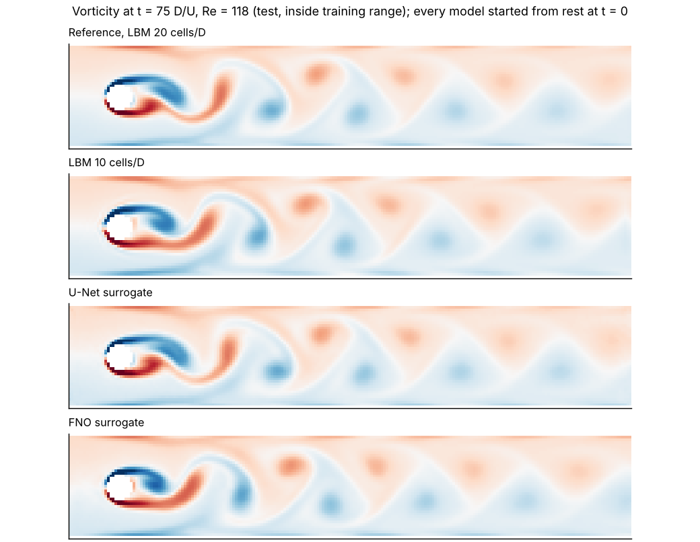
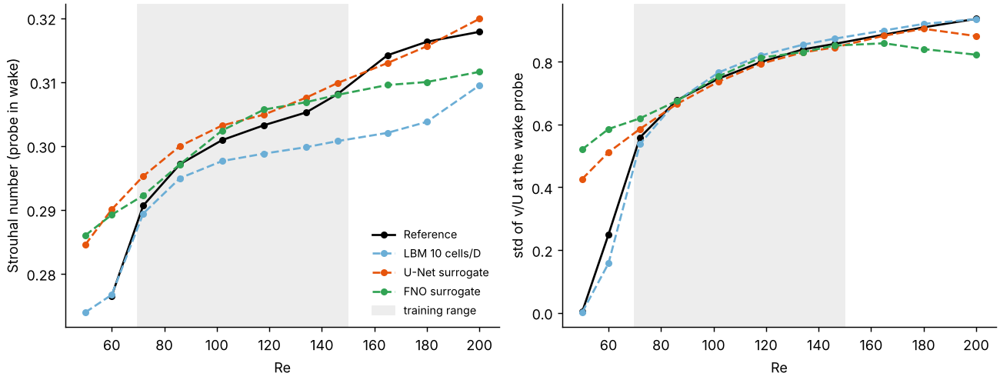
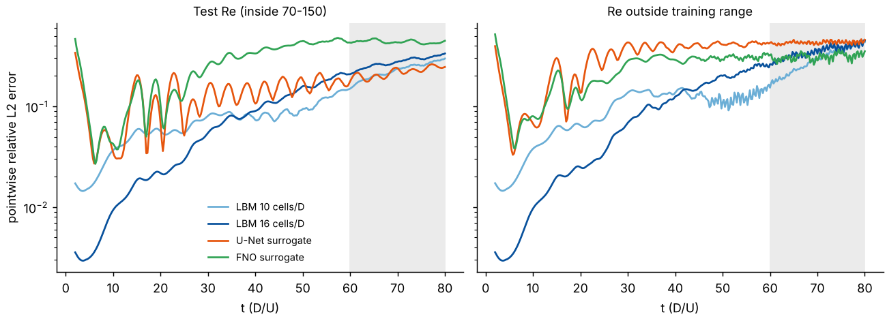
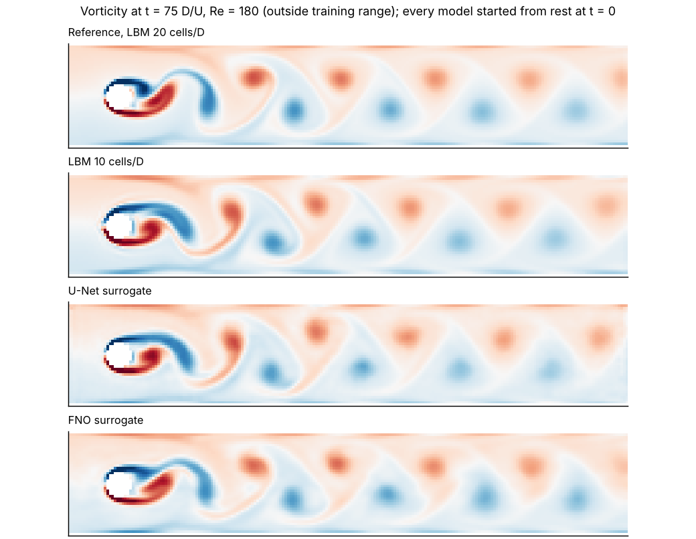
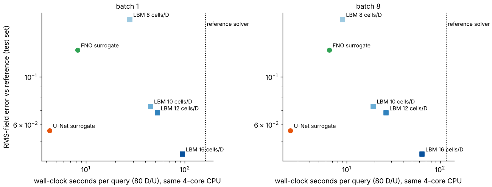
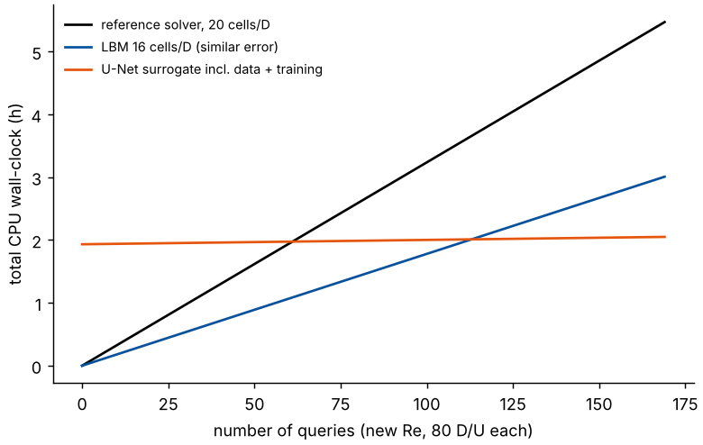

# How fast is a CFD surrogate, honestly?

A neural surrogate for 2D flow past a cylinder, benchmarked against the solver that made its training data **and** against cheaper versions of the same solver.

Most surrogate papers compare the network with the fine solver only. That gives a large speed-up. The fair question is different: how much faster is the network than the cheapest solver that gives the **same error**? And how many runs does it take to pay back the cost of the training data and the training? McGreivy and Hakim (2024) found that most ML-for-fluids papers do not answer these questions [Likely]. This repository answers them for one small problem, on one CPU, with all code in plain PyTorch.



## Result in one table

Test set: 6 Reynolds numbers between the 21 training values (Re 70 to 150). Every method starts from fluid at rest and runs to t = 80 D/U. Errors are relative L2 errors against the reference (lattice Boltzmann, 20 cells per diameter), computed on the same 220 x 41 grid for all methods. Cost: wall-clock seconds per run of 80 D/U, batch of 8 runs, same 4-core CPU.

| method | s per run | mean-field error | RMS-field error | Strouhal error |
|---|---|---|---|---|
| LBM 8 cells/D | 9.0 | 0.079 | 0.185 | 2.8% |
| LBM 10 cells/D | 19.3 | 0.056 | 0.073 | 1.3% |
| LBM 12 cells/D | 26.4 | 0.043 | 0.068 | 0.6% |
| LBM 16 cells/D | 64.1 | 0.021 | 0.044 | 1.0% |
| **U-Net surrogate** | **2.5** | 0.038 | 0.056 | 0.9% |
| FNO surrogate | 6.5 | 0.021 | 0.133 | 0.4% |
| LBM 20 cells/D (reference) | 116.5 | 0 | 0 | 0 |

All numbers are from one run of each script [Certain]. The full table, with the out-of-range sets, is in [results/summary.md](results/summary.md).

**What this says** [Certain for this setup, unless marked]:

1. **Naive speed-up: 47x.** The U-Net needs 2.5 s, the reference solver needs 116.5 s.
2. **Fair speed-up: 10x to 26x.** The U-Net error is between the 12 and 16 cells/D solvers. Against 12 cells/D (similar mean-field error) it is 10.6x faster. Against 16 cells/D (the cheapest solver with a lower RMS-field error) it is 25.6x faster.
3. **Pay-back: 61 to 291 runs.** Data (21 reference runs) plus training cost 1.9 h of CPU time. The U-Net pays this back after 61 runs if the alternative is the reference solver, after 113 runs against 16 cells/D, and after 291 runs against 12 cells/D. For a customer who needs 10 runs, the surrogate is a loss.
4. **It fails outside the training range, and it fails in the wrong direction.** At Re = 50, the reference flow has no vortex shedding by t = 80. Both surrogates predict strong shedding (see the right panel below). A surrogate trained only on shedding flows does not know that the shedding can stop. The coarse solvers get this right, because they contain the physics.
5. **The two architectures fail in different ways.** The FNO gets the mean flow as well as the 16 cells/D solver, but its fluctuation amplitude is 2x worse than the U-Net's. One metric alone would pick a different winner.



---

## Run it

```bash
pip install -r requirements.txt

python scripts/validate_dfg.py --d 20              # solver check, ~3 min
python scripts/generate.py --split train           # 21 reference runs, ~1.5 h on 4 cores
scripts/queue_eval_data.sh                         # test + OOD + coarse solvers, ~1.5 h
python scripts/train.py --model unet --minutes1 50 --minutes2 25
python scripts/train.py --model fno  --minutes1 50 --minutes2 25
python scripts/benchmark_speed.py                  # on an idle machine
python scripts/evaluate.py
python scripts/breakeven.py
python scripts/plots.py
```

The data (2.3 GB) is not in the repository. The trained weights are in `checkpoints/` (11 MB), so you can run `evaluate.py` without training. Times are from this machine: 4 CPU cores, no GPU, PyTorch 2.14 [Certain].

| file | content |
|---|---|
| `sbench/lbm.py` | Batched D2Q9 lattice Boltzmann solver in PyTorch (about 200 lines) |
| `sbench/data.py` | Splits, data generation, mapping of every grid to the common 220 x 41 grid |
| `sbench/models.py` | U-Net and 2D FNO |
| `sbench/dataset.py` | Normalization and the autoregressive stepper |
| `scripts/` | One script per step above |
| `results/` | All numbers in this README, as JSON |
| `figures/` | All plots in this README |

---

## 1. The problem and the solver

**Geometry.** The DFG benchmark 2D-2 of Schäfer and Turek (1996): a channel 0.41 high and 2.2 long, a cylinder of diameter D = 0.1 at (0.2, 0.2), a parabolic inlet profile with mean velocity U, no-slip walls, an open outlet [Certain]. The cylinder is 0.005 below the centre line, so the shedding starts without a manual perturbation. Re = U D / nu. I picked this case because it has published reference values. A solver that does not match them gives training data that is wrong [Certain].

**Solver.** A D2Q9 lattice Boltzmann method (LBM), written in PyTorch so that it runs a batch of Reynolds numbers at the same time. A network also runs in batches, so this makes the speed comparison fair.

- Regularized BGK collision (Latt and Chopard 2006).
- Full-way bounce-back on a staircase mask for the walls and the cylinder.
- Inlet and outlet by non-equilibrium extrapolation (Guo et al. 2002), with density 1 at the outlet.
- The inlet velocity ramps up over 15 D/U.
- Forces on the cylinder by momentum exchange.

**What failed first** (each one cost time, and each one is a good interview story):

- **TRT collision blew up** at 10 cells/D for Re >= 150 (tau = 0.515). The regularized collision is stable for all cases here [Certain, from the runs].
- **A fast inlet start (2 D/U) made a standing pressure wave** between inlet and outlet. The mass flux in the channel oscillated by up to 40%, and still by more than 10% after 40 D/U. The drag oscillated with it [Certain, from the runs]. A velocity inlet and a pressure outlet make a closed-open pipe, and LBM is weakly compressible, so this is an acoustic resonance [Likely]. The 15 D/U ramp removes most of it.
- **The first outlet (zero gradient) let the mean density drift.** A fixed-density outlet fixed it.

**Check against the benchmark** (Re = 100, last quarter of an 80 D/U run, 60 D/U for 40 cells/D) [Certain, from the runs]:

| cells per D | grid | Cd max | Cl max | St |
|---|---|---|---|---|
| 10 | 220 x 41 | 3.84 | 1.01 | 0.297 |
| 20 (reference) | 440 x 82 | 3.50 | 1.06 | 0.301 |
| 40 | 880 x 164 | 3.36 | 1.04 | 0.305 |
| DFG reference | | 3.22 to 3.24 | 0.99 to 1.01 | 0.295 to 0.305 |

The Strouhal number is inside the reference interval on all grids. The maximum drag converges towards the reference from above, but slowly: it is 8% high at 20 cells/D and 4% high at 40 cells/D. A staircase cylinder and first-order bounce-back give first-order convergence at the wall [Likely]. So the reference data in this project has an error of a few percent in the drag. All methods are compared with this reference, not with the true flow. **A surrogate can never be more accurate than its training data**, and "error against the reference" is not "error against reality".

## 2. Data

- **Training:** 21 runs, Re = 70, 74, ..., 150. Two of them (Re 78 and 126) are held out for model selection.
- **Test:** Re = 72, 86, 102, 118, 134, 146 (between the training values).
- **Out of range:** Re = 50, 60 (below) and 165, 180, 200 (above).
- Each run: 0 to 80 D/U, one frame every 0.25 D/U (321 frames, about 13 per shedding period). Fields u/U, v/U and p/(rho U^2), averaged 2 x 2 from the 440 x 82 grid onto the 220 x 41 grid.
- **Coarse-solver baselines:** the same solver at 8, 10, 12 and 16 cells/D, for the test and out-of-range sets, mapped onto the same 220 x 41 grid. The 10 cells/D solver is native on that grid; the others use bilinear interpolation.

## 3. Models and training

Both models learn one time step of 0.25 D/U: input (u, v, p, mask, x, y, Re), output the change of (u, v, p). A run is then a rollout of 320 steps from fluid at rest.

| | U-Net | FNO |
|---|---|---|
| idea | local convolutions, 3 down-sampling levels | global Fourier layers (Li et al. 2021), 12 x 20 modes, zero padding because the channel is not periodic |
| parameters | 0.51 M | 1.11 M (complex weights counted once) |

**Training** (75 min per model, 2 threads, `scripts/train.py`):

1. One-step training with noise on the input (0.5 x the standard deviation of one step), 50 min. The noise teaches the model to correct its own small errors in a rollout (as in Sanchez-Gonzalez et al. 2020).
2. Unrolled training: 4 steps in a row, the gradient goes through the model's own predictions, 25 min.

The unrolled stage gave the largest gain of the whole project [Certain, from the validation log]. The 40-step rollout error on the validation runs went from 0.108 to 0.038 for the U-Net, and from 0.041 to 0.034 for the FNO. A model that has a good one-step loss can still drift in a rollout. This is the same lesson as Example 4 in my earlier study notes.

## 4. Results

### Accuracy: which metric?



The pointwise error grows with time for **every** method, also for the 16 cells/D solver. The reason: a small error in the shedding frequency shifts the phase of the vortex street. After enough periods, a correct-looking flow has a pointwise error of order 0.3 [Certain, from the plot]. A pointwise error after a long rollout tells you little about the quality of a model. So the main metrics here do not depend on phase. They are computed over t = 60 to 80 D/U:

- **mean-field error:** error of the time-averaged field (what a design engineer uses for pressure drop and mean loads)
- **RMS-field error:** error of the field of temporal standard deviation (fluctuation amplitude, fatigue, mixing)
- **Strouhal number** and **amplitude** of v at a probe 3 D behind the cylinder

The surrogates are worse than the coarse solvers early in the run (t = 10 to 30, the start of shedding). Later, the U-Net is similar to the solvers and the FNO stays higher [Certain, from the plot]. The start of shedding is an instability that grows from a very small signal, so a small error in the model changes when it starts [Likely].

### Out of range

| method | Re 165 to 200: mean-field | RMS-field | St | Re 50 to 60: mean-field | RMS-field |
|---|---|---|---|---|---|
| LBM 10 cells/D | 0.076 | 0.123 | 3.5% | 0.050 | 0.130 |
| LBM 16 cells/D | 0.037 | 0.077 | 1.8% | 0.019 | 0.051 |
| U-Net | 0.067 | 0.227 | 0.4% | 0.119 | **1.207** |
| FNO | 0.069 | 0.321 | 1.8% | 0.132 | **1.388** |

Above the training range, the surrogates degrade slowly. The Strouhal number is still good, the amplitude gets worse as Re goes up [Certain, from the plot]. Below the range, they are wrong in kind: they predict shedding where the flow has none (Re 50), and a 2x too strong wake where the shedding is weak (Re 60) [Certain, from the plot]. In an interview, this is the most important plot. **Extrapolation across a bifurcation is where a data-only model fails without a warning.**



### Cost against error



A method is useful only if no other method is both cheaper and more accurate. On the RMS-field error, the U-Net is on that front: no solver is both cheaper and more accurate [Certain, from the plot]. The FNO is not: the 10 cells/D solver is more accurate on the RMS-field error and only 3x slower. With batch 1 (one query at a time), the U-Net gains against the coarse solvers: 10.5x faster than 10 cells/D, against 7.7x with batch 8. A small LBM grid uses the CPU badly when it runs alone [Likely].

### Break-even



Offline cost of the U-Net: 21 reference runs (2447 s at the batch-8 speed) plus training (4512 s) = 6959 s, about 1.9 h [Certain]. Number of runs to pay this back ([results/breakeven.json](results/breakeven.json)):

| alternative | cost per run | break-even |
|---|---|---|
| reference solver, 20 cells/D | 116.5 s | 61 runs |
| 16 cells/D (lower RMS-field error than the U-Net) | 64.1 s | 113 runs |
| 12 cells/D (similar mean-field error) | 26.4 s | 291 runs |

---

## Read these results skeptically

1. **My solver is slow, so all speed-ups are too high.** The PyTorch LBM does about 10 million lattice updates per second on 4 cores [Certain, from `results/speed.json`]. Optimized LBM codes on a CPU are faster by a factor of about 10 or more [Likely, I did not measure one here]. A faster solver moves every square in the cost plot to the left, and the break-even numbers go up by the same factor. A commercial finite-volume solver would be a different comparison again.
2. **The training time is too low and too high.** It was measured while other jobs used the other 2 cores (too high). It also excludes my tuning time and the failed solver versions (too low) [Certain].
3. **One seed per model.** The difference between U-Net and FNO, and between the U-Net and the 12 cells/D solver, can be smaller than the seed-to-seed spread. The U-Net RMS-field error goes from 0.026 to 0.12 over the 6 test cases [Certain, from `results/accuracy.json`].
4. **The surrogate has a home advantage.** It learns the 2 x 2 average of the fine solution directly. The coarse solvers must compute it with a coarser staircase cylinder. This is the real source of the gain (the same idea as Kochkov et al. 2021) [Likely], but it also means that the surrogate copies the reference's errors, including its 8% drag error.
5. **This problem is easy.** 2D, laminar, one parameter (Re), one geometry. A real customer has 3D, turbulence, and new geometries. A surrogate of this kind does not generalize to a new geometry at all [Certain: geometry is not an input].
6. **The U-Net Strouhal number is biased by about +1%** in the training range (higher than the reference at all 6 test values) [Certain, from the plot]. A bias of the same sign at all points is a systematic model error, not noise.

## What I would do next

- Train 3 seeds per model and give error bars.
- Add an uncertainty estimate (an ensemble of 5 U-Nets). Then check that the spread is large at Re = 50, where the model is wrong.
- Add training data at Re 40 to 70, across the onset of shedding, and check whether the bifurcation is learned.
- Make geometry an input (cylinder position and size), with a graph network on the real mesh (MeshGraphNets, Pfaff et al. 2021).
- Compare against an optimized solver, for example a compiled LBM code or OpenFOAM at matched error.

## Interview sentences

"I trained a U-Net surrogate for vortex shedding behind a cylinder. Against the solver that made the data it was 47 times faster. Against a coarser solver with the same error it was only 10 to 26 times faster, and it needed 60 to 300 runs to pay back the data and training. Below the training range it predicted vortex shedding where the real flow is steady. So before I recommend a surrogate to a customer, I ask how many runs they need, and whether their parameter range crosses a change of flow regime."

## References

- Schäfer, Turek (1996), *Benchmark computations of laminar flow around a cylinder*, Notes on Numerical Fluid Mechanics 52 [Certain]
- McGreivy, Hakim (2024), *Weak baselines and reporting biases lead to overoptimism in machine learning for fluid-related partial differential equations*, Nature Machine Intelligence [Likely on the exact title]
- Kochkov et al. (2021), *Machine learning-accelerated computational fluid dynamics*, PNAS [Certain]
- Latt, Chopard (2006), *Lattice Boltzmann method with regularized pre-collision distribution functions*, Math. Comput. Simul. [Likely on the journal]
- Guo, Zheng, Shi (2002), *Non-equilibrium extrapolation method for velocity and pressure boundary conditions in the lattice Boltzmann method*, Chinese Physics [Certain]
- Li et al. (2021), *Fourier Neural Operator for Parametric PDEs*, ICLR [Certain]
- Ronneberger, Fischer, Brox (2015), *U-Net*, MICCAI [Certain]
- Sanchez-Gonzalez et al. (2020), *Learning to Simulate Complex Physics with Graph Networks*, ICML [Certain]
- Pfaff et al. (2021), *Learning Mesh-Based Simulation with Graph Networks*, ICLR [Certain]
- Brandstetter, Worrall, Welling (2022), *Message Passing Neural PDE Solvers*, ICLR (training on the model's own rollouts) [Certain]

License: MIT.
